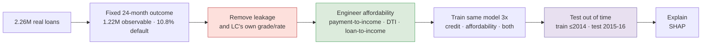
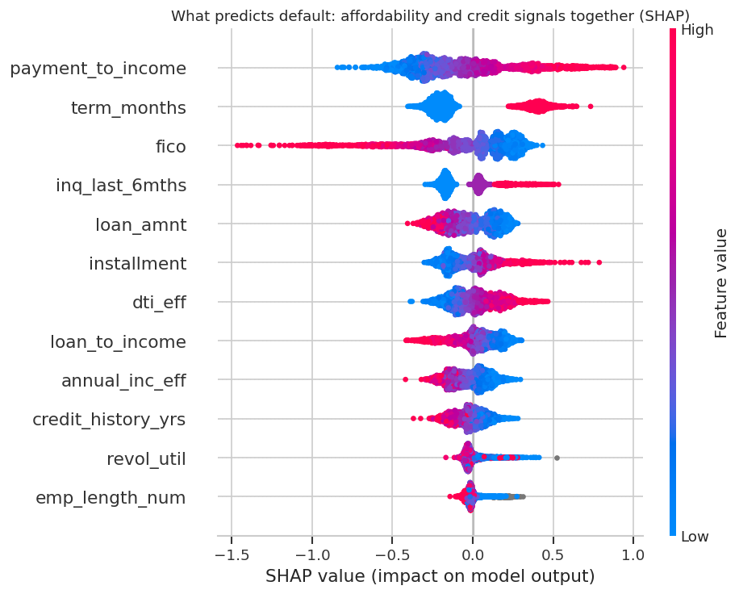
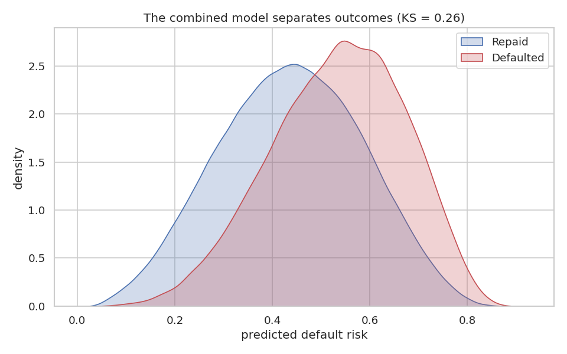

# Can They Afford to Repay? Affordability-Based Default Risk

Traditional lending leans on the credit score: a backward-looking measure of how someone has handled debt before. A growing part of the industry argues the more important question is **affordability**, whether someone can actually afford the repayments given their income and existing obligations. This project tests that idea on **1.22 million real Lending Club loans** whose 24-month outcome is known, training on loans issued up to 2014 and testing on loans issued in 2015-2016.

**The headline:** out of time, affordability features on their own predict 24-month default **better than a credit score plus a full bureau record** (ROC-AUC 0.683 vs 0.620), and even among borrowers with the same FICO score, those with worse affordability default far more often. Adding the bureau data to affordability adds almost nothing out of time.

---

## Results at a glance

The **same** XGBoost model, trained on three different feature sets (so any difference is the features, not the algorithm). Trained on 466,340 loans issued up to 2014, tested on 751,956 loans issued in 2015-2016:

| Feature set | ROC-AUC | PR-AUC |
|---|---|---|
| Credit score + bureau record | 0.620 | 0.166 |
| **Affordability only** | **0.683** | **0.216** |
| Both combined | 0.683 | 0.218 |
| *No-skill baseline* | 0.500 | 0.116 |

Affordability alone beats the credit score. On a random split the combined model edges ahead (0.690 vs 0.683), but that gain does not survive the move to later borrowers.

---

## How it works



Four things make this a fair test:

- **Affordability measured from income.** With borrower income, the monthly instalment and reported debt-to-income, affordability is computed properly: payment-to-income, loan-to-income and DTI, joint-aware for joint applications.
- **A fixed outcome window.** Default means charged off with a default date (last payment plus four months, about 90 days past due) within **24 months of issue**. Only loans whose whole window had passed by the data snapshot (March 2019) are used: 1.22M loans issued up to September 2016, 10.8% of which defaulted. Keeping only *finished* loans, as earlier versions did, over-represents defaults in recent vintages, because the loans still running are mostly the good ones.
- **Out-of-time testing.** The model trains on loans issued up to 2014 and is tested on 2015-2016 loans it never saw, as a lender would use it.
- **No leakage, no circularity.** Every post-origination field (payments made, recoveries, updated FICO) is dropped, and so are Lending Club's own grade and interest rate, which already bake in its internal risk model. The model sees only what a lender would know at the point of decision.

---

## 1. The affordability gradient


The simplest form of the idea: the more of someone's income a loan consumes, the more likely they are to default. It holds across three different affordability measures. By payment-to-income, the 24-month default rate climbs from **7.7% (under 5% of income) to 20.4% (over 20%)**, and the same rising pattern appears for debt-to-income and loan-to-income.

## 2. Affordability adds signal the credit score misses


If affordability were just a proxy for creditworthiness, it would add nothing once you know the FICO score. Reading **down** a column, default falls as the credit score rises; reading **across** a row, default rises as affordability worsens, **at the same credit score**. Within the 700-720 band, the 24-month default rate runs from 7% (DTI under 10) to 19% (DTI over 40). A 720-740 borrower with DTI over 40 (14%) is riskier than a 660-680 borrower with DTI under 10 (10%).

## 3. The test: credit score vs affordability vs both


The same model, three feature sets, tested on later borrowers. **Affordability features alone reach ROC-AUC 0.683, ahead of the 0.620 from a credit score and full bureau record.** Combining them gives 0.683 (PR-AUC 0.218 vs 0.216): on this population, once affordability is known, the bureau fields add little. Part of the reason is that Lending Club's approved borrowers sit in a narrow FICO range (80% between 660 and 720), which limits what the score can do here.

## 4. What the combined model keys on



SHAP on the combined model puts **payment-to-income** first, then loan **term** (sixty-month loans defaulted at 13.7% within 24 months against 9.6% for thirty-six), the **credit score**, recent credit enquiries, and further affordability measures (loan amount, instalment, DTI, loan-to-income). SHAP describes how the model uses each feature, not cause and effect: term partly reflects who chooses a longer loan.

## 5. Income, on its own, tracks default


Sorting borrowers into income deciles, the 24-month default rate falls steadily from 13.8% in the lowest decile to 7.6% in the highest. Income is not just a denominator in an affordability ratio; it is a risk signal in its own right.

## 6. How well the combined model separates outcomes



The two predicted-risk distributions, repaid versus defaulted, give a KS statistic of **0.26** out of time. That is modest, and expectedly so: Lending Club has already screened out the weakest applicants, so the surviving population is harder to separate than a general one. The ranking is real, but this is a hard problem rather than a solved one.

Every number above is in [`results.json`](results.json), written by `analysis.py`.

---

## Data, leakage and licence

The data is **Lending Club's publicly released accepted-loans dataset (2007-2018)**, obtained via Kaggle. `build_dataset.py` turns the raw file into the modelling table (`data/lending_affordability.parquet`, about 53 MB, all 2.26M loans with their outcome windows). Neither the raw file nor the derived table is redistributed here: the table is now above GitHub's recommended file size, and the loan data is Lending Club's. The **code** is MIT-licensed (see `LICENSE`); consult the original source for the data's terms before any non-portfolio use.

> Lending Club accepted-loans data, 2007-2018Q4, via Kaggle (`wordsforthewise/lending-club`).

---

## Run it

```bash
pip install -r requirements.txt
# 1. download accepted_2007_to_2018Q4.csv.gz from Kaggle into data/raw/ (or set LENDING_CLUB_CSV to its path)
python build_dataset.py                   # builds data/lending_affordability.parquet (about 30 seconds)
python analysis.py                        # all six figures and results.json
pip install jupytext nbclient ipykernel   # only needed to rebuild the notebook
python make_notebook.py                   # rebuilds and runs the notebook from analysis.py
```

The notebook is generated from `analysis.py` (which is written in notebook cell format), so the two always match.

## Repo structure

```
.
├── affordability_default_risk.ipynb   # narrative version, generated from analysis.py and executed
├── analysis.py                         # the analysis (runs as a script; cells marked for the notebook)
├── build_dataset.py                    # builds the modelling table from the raw Kaggle CSV
├── lending_club.py                     # shared loader: outcome windows, snapshot, default dating
├── make_notebook.py                    # converts analysis.py to the notebook and runs it
├── results.json                        # every number quoted above
├── CHANGES.md                          # what changed and why, with old and new numbers
├── requirements.txt
├── data/                               # local only (git-ignored): raw file and modelling table
└── figures/                            # generated charts
```

---

## Limitations

- **Approved loans only.** Lending Club already declined the riskiest applicants, so this models repayment among the *approved*. That narrows the FICO range and compresses how separable the population is (the modest KS reflects it). There is no reject inference.
- **Approximate default dating.** The file has no delinquency history, so default is dated at last payment plus four months.
- **One test period.** The out-of-time test covers loans issued in 2015-2016, observed through a benign US credit period. Results under stress are untested.
- **Self-reported income**, only partly verified, so affordability ratios carry some noise.
- **Scores would need calibrating** before being read as probabilities of default; the class weighting used in training inflates raw scores.
- **A US platform, 2007-2018.** The affordability *principle* travels; the exact thresholds do not.

*Data: Lending Club accepted-loans dataset (2007-2018), via Kaggle.*
