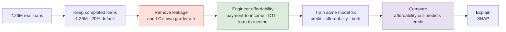
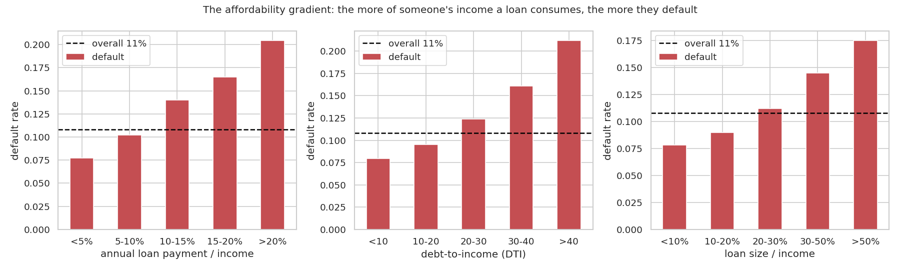
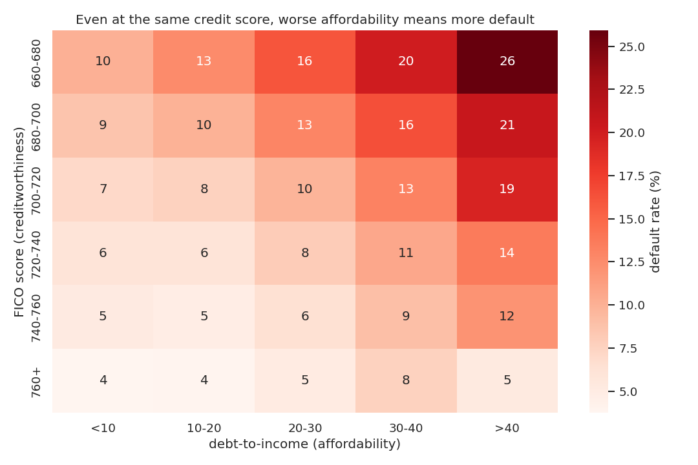
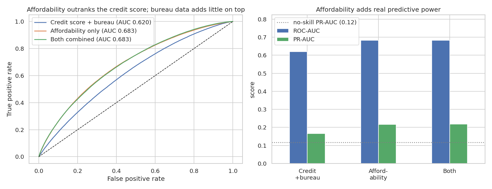
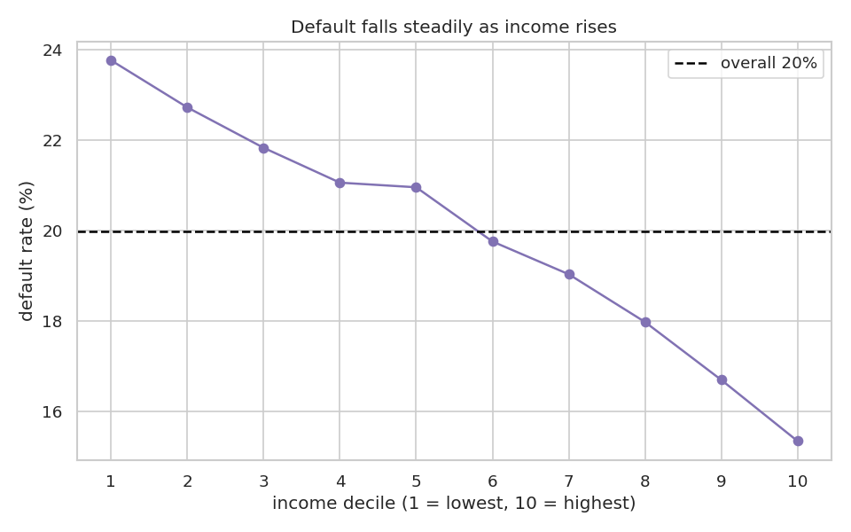

# Can They Afford to Repay? Affordability-Based Default Risk

Traditional lending leans on the credit score: a backward-looking measure of how someone has handled debt before. A growing part of the industry argues the more important question is **affordability**, whether someone can actually afford the repayments given their income and existing obligations. This project tests that idea head-on, on **1.35 million real, completed Lending Club loans**.

**The headline:** affordability features on their own predict default **better than a credit score plus a full bureau record**, and even among borrowers with an identical FICO score, those with worse affordability default far more often.

---

## Results at a glance

The **same** XGBoost model, trained on three different feature sets (so any difference is the features, not the algorithm):

| Feature set | ROC-AUC | PR-AUC |
|---|---|---|
| Credit score + bureau record | 0.617 | 0.271 |
| **Affordability only** | **0.699** | **0.361** |
| Both combined | 0.706 | 0.371 |
| *No-skill baseline* | 0.500 | 0.200 |

Affordability alone beats the credit score, and the two are complementary.

---

## How it works



Three things make this a fair test:

- **Affordability measured from income.** With borrower income, the monthly instalment and reported debt-to-income, affordability is computed properly: payment-to-income, loan-to-income and DTI, joint-aware for joint applications.
- **Real outcomes only.** Just loans that have finished (fully paid, or charged off / defaulted), a 20% default rate across 1.35M loans.
- **No leakage, no circularity.** Every post-origination field (payments made, recoveries, updated FICO) is dropped, and so are Lending Club's own grade and interest rate, which already bake in its internal risk model. The model sees only what a lender would know at the point of decision.

---

## 1. The affordability gradient



The simplest form of the idea: the more of someone's income a loan consumes, the more likely they are to default. It holds across three different affordability measures. By payment-to-income, the default rate climbs from **14% (under 5% of income) to 34% (over 20%)**, and the same monotonic pattern appears for debt-to-income and loan-to-income.

## 2. Affordability adds signal the credit score misses



This is the crux of the project. If affordability were just a proxy for creditworthiness, it would add nothing once you know the FICO score. It does not work out that way. Reading **down** a column, default falls as the credit score rises; reading **across** a row, default rises as affordability worsens, **at the same credit score**. A 760+ borrower with a stretched budget (14%) is riskier than a 660-680 borrower with plenty of room (19% at the lowest DTI, but only because the whole row is higher). Within the 700-720 band alone, default runs from 14% to 35% purely on affordability.

## 3. The test: credit score vs affordability vs both



The same model, three feature sets. The result is the point of the whole project: **affordability features alone reach ROC-AUC 0.70, ahead of the 0.62 from a credit score and full bureau record**, and combining the two lifts it to 0.71. Affordability is not a nice-to-have here; it is the stronger signal.

## 4. What the combined model keys on


SHAP on the combined model shows a healthy blend: loan **term** (sixty-month loans default far more than thirty-six), the **credit score**, and then a stack of **affordability** signals, payment-to-income, instalment size, DTI and loan amount, sitting right next to the credit features. Neither lens alone tells the whole story.

## 5. Income, on its own, tracks default



Sorting borrowers into income deciles, default falls steadily from the lowest income band to the highest. Income is not just a denominator in an affordability ratio; it is a risk signal in its own right.

## 6. How well the combined model separates outcomes


The two predicted-risk distributions, repaid versus defaulted, give a KS statistic of **0.30**. That is modest, and expectedly so: Lending Club has already screened out the weakest applicants, so the surviving population is harder to separate than a general one. The ranking is real, but this is a genuinely hard problem rather than a solved one, and the writeup says so plainly.

---

## Data, leakage and licence

The data is **Lending Club's publicly released accepted-loans dataset (2007-2018)**, obtained via Kaggle. The repository ships the **cleaned, derived parquet** (about 30 MB) plus `build_dataset.py`, which reconstructs it from the raw Kaggle file; the raw 1.6 GB CSV is not redistributed here. The **code** is MIT-licensed (see `LICENSE`); the underlying loan data is Lending Club's, so consult the original source for its terms before any non-portfolio use.

> Lending Club accepted-loans data, 2007-2018Q4, via Kaggle (`wordsforthewise/lending-club`).

---

## Run it

```bash
pip install -r requirements.txt
# the cleaned dataset ships with the repo; to rebuild it from the raw Kaggle file:
# python build_dataset.py
python analysis.py                       # reproduces all six figures
# or open the narrative version:
jupyter notebook affordability_default_risk.ipynb
```

## Repo structure

```
.
├── affordability_default_risk.ipynb   # narrative analysis (executed, 6 figures)
├── analysis.py                         # same analysis as a script
├── build_dataset.py                    # rebuilds the clean dataset from the raw Kaggle CSV
├── README.md
├── LICENSE
├── requirements.txt
├── data/                               # cleaned, derived parquet (1.35M loans)
└── figures/                            # generated charts
```

---

## Limitations

- **Survivorship in the data.** Lending Club already declined the riskiest applicants, so this models repayment among the *approved*, which compresses how separable the population is (the modest KS reflects exactly that).
- **Self-reported income**, only partly verified, so affordability ratios carry some noise.
- **Scores would need calibrating** before being read as probabilities of default.
- **A US platform, 2007-2018.** The affordability *principle* travels; the exact thresholds do not.

*Data: Lending Club accepted-loans dataset (2007-2018), via Kaggle.*
